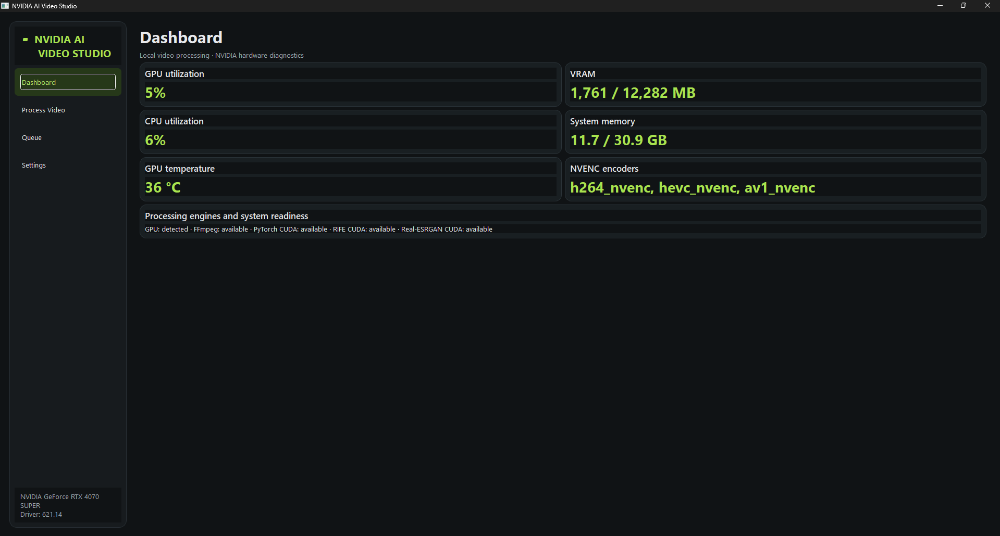
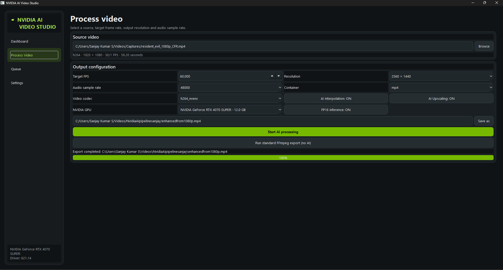
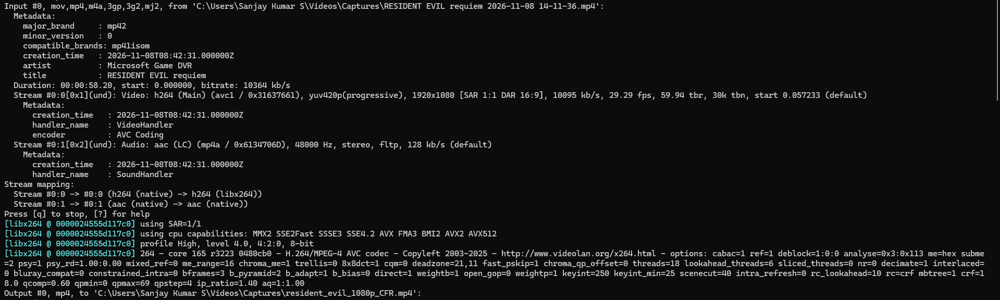
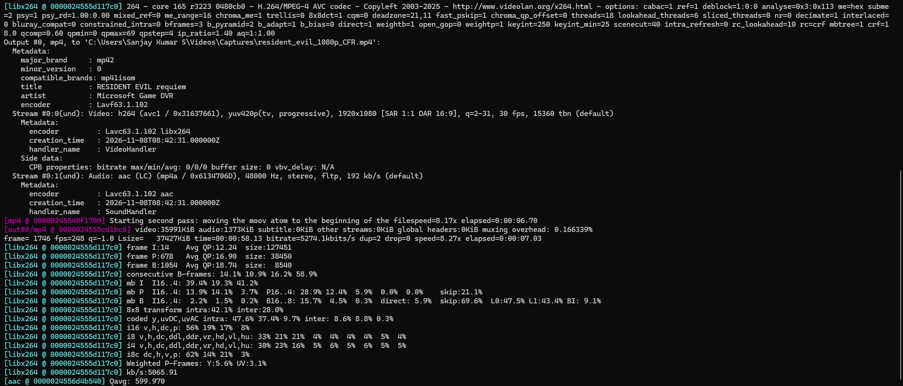
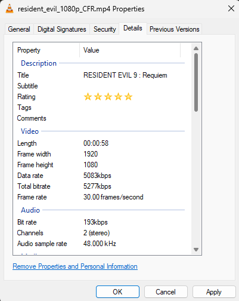
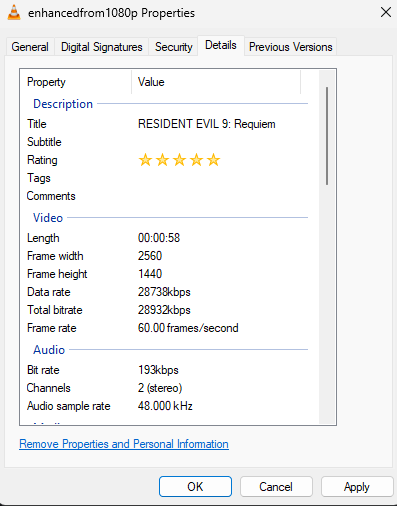

# NVIDIA AI Video Studio

### V1.0.0 — Imaginoromancophilia

**An experimental, Windows-first desktop application for NVIDIA GPU-accelerated AI video upscaling and frame interpolation.**

NVIDIA AI Video Studio brings an AI video-processing pipeline into a desktop application built around PyTorch, CUDA, RIFE, Real-ESRGAN and FFmpeg. It provides configurable video output settings and visibility into the hardware being used during processing.

V1 is the first public milestone: a functional end-to-end implementation, validated on an NVIDIA GeForce RTX 4070 SUPER 12 GB desktop GPU. It is an early release, and its current limitations are documented below.

> **Project status:** V1.0.0 — Imaginoromancophilia  
> **Platform:** Windows  
> **Validated GPU:** NVIDIA GeForce RTX 4070 SUPER 12 GB  
> **Project licence declared in package metadata:** GPL-3.0-or-later

---

## Contents

- [What is NVIDIA AI Video Studio?](#what-is-nvidia-ai-video-studio)
- [Why build this when alternatives already exist?](#why-build-this-when-alternatives-already-exist)
- [V1 demonstration](#v1-demonstration)
- [What V1 actually does](#what-v1-actually-does)
- [The processing workflow](#the-processing-workflow)
- [V1 results and observations](#v1-results-and-observations)
- [Performance observations](#performance-observations)
- [Known limitations](#known-limitations)
- [V2 development](#v2-development)
- [Technology stack and acknowledgements](#technology-stack-and-acknowledgements)
- [Getting started from source](#getting-started-from-source)
- [Validation](#validation)
- [Licensing and third-party notices](#licensing-and-third-party-notices)

---

## What is NVIDIA AI Video Studio?

NVIDIA AI Video Studio is a local desktop application designed to combine AI-based video frame interpolation and super-resolution in one configurable workflow.

The application uses:

- **RIFE v4.25** to generate intermediate frames and increase the output frame rate.
- **Real-ESRGAN** to perform AI-based image super-resolution on video frames.
- **PyTorch with CUDA** to execute the neural-network inference on an NVIDIA GPU.
- **FFmpeg and FFprobe** to inspect, decode, process and encode video and audio streams.
- **NVIDIA NVML telemetry** to display GPU usage, VRAM, temperature and related hardware information.

The application is designed around local processing. Video processing happens on the machine running the application; it does not require uploading the video to a remote enhancement service. An internet connection is required for the first download of model checkpoints unless they have already been cached.

The goal of V1 was to prove that these components could be integrated into a single Windows desktop workflow and produce a valid enhanced video file.

---

## Why build this when alternatives already exist?

There are already excellent applications for video enhancement. NVIDIA AI Video Studio does not claim to be the first, the fastest, or the best video upscaler.

Existing tools solve different problems, and many of them are more mature than this V1 release.

Examples include:

| Tool | What it offers | How this project differs |
|---|---|---|
| [Topaz Video](https://www.topazlabs.com/topaz-video) | Commercial desktop video enhancement, AI upscaling, interpolation, restoration and other models. | This project is an open-source-oriented implementation that exposes its own processing stack and configuration. |
| [NVIDIA RTX Video](https://www.nvidia.com/en-us/geforce/technologies/rtx-video/) | AI video enhancements, including Super Resolution, for supported playback scenarios. | This project focuses on rendering a new output video file with a selected resolution and target frame rate. |
| [Video2X](https://github.com/k4yt3x/video2x) | Open-source video super-resolution and frame-interpolation framework. | This project is a separate Windows-first desktop implementation with its own PySide6 interface and integrated NVIDIA telemetry. |
| [REAL Video Enhancer](https://github.com/TNTwise/REAL-Video-Enhancer) | Open-source video interpolation and upscaling application with multiple backends and platform support. | This project is an independent implementation and a learning/research-oriented application built around its current PyTorch CUDA pipeline. |

These alternatives are worth exploring. They may be better choices for users who need a mature feature set, broader hardware support, or higher processing throughput today.

### So why build another one?

**1. Control over the complete processing pipeline**

Instead of treating enhancement as a black box, the project brings the individual stages together:

- Inspect the source video.
- Select a target frame rate.
- Select an output resolution.
- Enable or disable AI interpolation and upscaling.
- Configure the output container and video codec.
- Configure the audio sample rate.
- Select the available NVIDIA GPU.
- Observe GPU and system resource usage.

This makes the processing path easier to inspect, understand and experiment with.

**2. Local processing and control over media**

Personal recordings, gameplay captures and other large video files do not need to be uploaded to a third-party service for the local processing workflow. The user retains the source and output files on their own machine.

This also avoids depending on a cloud-rendering credit system for the processing performed by this application. Local processing does, however, depend on the user's own hardware and can take considerably longer.

**3. An open and inspectable implementation**

The application is built using established open-source libraries and published model implementations. This makes the processing pipeline more approachable for developers who want to understand how frame interpolation, super-resolution, GPU inference and video encoding fit together.

**4. An NVIDIA-focused engineering project**

The application uses CUDA-enabled PyTorch inference, FP16 where available, GPU-aware tiling and NVIDIA hardware telemetry. It also exposes hardware encoder options when supported by the installed FFmpeg build and NVIDIA driver.

V1 is not a universal benchmark or a replacement for every vendor-specific enhancement technology. It is a practical implementation whose performance and compatibility can be measured and improved.

**5. A project that can evolve**

The project is also an exercise in integrating computer vision, deep learning, desktop application development, GPU programming and media engineering into one usable application.

The important result of V1 is not simply that a video became larger or smoother. It is that the complete pipeline was integrated, executed on a physical NVIDIA GPU, and produced a playable output file with the expected resolution and frame-rate metadata.

---

## V1 demonstration

The following two videos use the same gameplay recording as the basis for an original-versus-enhanced comparison.

### AI-upscaled and interpolated output

[](https://www.youtube.com/watch?v=4B6UuXTA_NI)

**Output:** 2560 × 1440, 60 FPS

[Watch the enhanced video on YouTube](https://www.youtube.com/watch?v=4B6UuXTA_NI)

### Original gameplay recording

[](https://www.youtube.com/watch?v=t4xxRYU7Q90)

**Original capture:** 1920 × 1080, variable frame rate

[Watch the original video on YouTube](https://www.youtube.com/watch?v=t4xxRYU7Q90)

The videos are hosted on YouTube so that the large media files do not need to be stored in the Git repository.

### Application screenshots

#### 1. Dashboard — NVIDIA hardware telemetry



The dashboard displays GPU utilization, VRAM usage, CPU utilization, system memory, GPU temperature and available NVIDIA encoder capabilities.

The values shown are a snapshot from the machine at the time of capture, not a performance benchmark.

#### 2. Process Video — output configuration



The V1 processing screen exposes the selected source video and output configuration.

The demonstrated configuration includes:

- Target frame rate: **60 FPS**
- Output resolution: **2560 × 1440**
- Audio sample rate: **48,000 Hz**
- Container: **MP4**
- Video encoder selection: **H.264 NVENC**
- AI interpolation: **Enabled**
- AI upscaling: **Enabled**
- FP16 inference: **Enabled**

#### 3. FFmpeg — preparing the source video



The original gameplay capture was variable frame rate. Since V1 does not currently process VFR inputs directly, the source was converted into a constant-frame-rate intermediate before it was passed to the application.

This was a full-resolution conversion. The video was not downscaled for preprocessing.

#### 4. FFmpeg — conversion completion



The intermediate file was prepared at 1920 × 1080 and 30 FPS. This step produced a predictable input timing grid for the V1 processing workflow.

#### 5. Original video properties



The CFR intermediate had the following properties:

- Resolution: 1920 × 1080
- Frame rate: 30 FPS
- Duration: approximately 58 seconds
- Audio: stereo, 48 kHz

#### 6. Enhanced video properties



The final output had the following properties:

- Resolution: 2560 × 1440
- Frame rate: 60 FPS
- Duration: approximately 58 seconds
- Audio: stereo, 48 kHz

---

## What V1 actually does

### AI frame interpolation

V1 integrates Practical-RIFE v4.25 inference.

RIFE estimates intermediate frames between existing frames. In the demonstration, the source intermediate was 30 FPS and the requested output was 60 FPS.

This is actual frame interpolation, rather than simply changing the frame-rate metadata.

### AI super-resolution

V1 integrates Real-ESRGAN x2plus and x4plus inference.

The model is selected according to the requested scaling ratio. Tiled inference limits the size of individual processing regions, helping manage GPU memory usage.

The demonstrated output was 1440p from a 1080p source. It should not be interpreted as a validated 4K or 8K end-to-end result.

### CUDA and FP16 inference

The neural-network inference runs through a CUDA-enabled PyTorch installation.

FP16 inference is available for the supported models and hardware. In the integrated pipeline, the RIFE-to-Real-ESRGAN intermediate is kept on the CUDA device rather than being copied back to system memory between those two inference stages.

The current implementation still uses CPU-side decoded RGB frames and transfers completed output frames back for video encoding.

### NVIDIA hardware monitoring

The dashboard uses NVIDIA telemetry to display GPU-related information, including utilization, temperature, VRAM and available encoder capabilities.

CPU and system memory usage are also displayed.

### FFmpeg video processing

FFmpeg and FFprobe are used for media inspection and video processing.

The application can use an NVIDIA hardware encoder when the selected NVENC encoder is available in the installed FFmpeg build and supported by the installed driver.

Audio is mapped from the source and can be resampled to the configured sample rate.

---

## The processing workflow

The demonstration used the following sequence:

1. **Original capture:** A Microsoft Game DVR gameplay recording at 1920 × 1080. The file was variable frame rate, with an average frame rate of approximately 29.29 FPS and a nominal rate of 59.94 FPS.
2. **CFR preparation:** FFmpeg converted the source to a full-resolution 1920 × 1080, 30 FPS constant-frame-rate intermediate.
3. **Frame interpolation:** RIFE v4.25 generated intermediate frames to reach the selected 60 FPS output.
4. **Super-resolution:** Real-ESRGAN x2plus performed AI upscaling, followed by fitting the result to the requested 2560 × 1440 output canvas.
5. **Encoding:** The application produced an MP4 output using the configured video-encoding workflow.
6. **Audio:** The resulting file retained stereo audio at 48 kHz.

The CFR conversion was a preprocessing requirement for this V1 demonstration. Native variable-frame-rate processing is not yet supported.

---

## V1 results and observations

| Measurement | Original CFR intermediate | Enhanced output |
|---|---:|---:|
| Resolution | 1920 × 1080 | 2560 × 1440 |
| Frame rate | 30 FPS | 60 FPS |
| Duration | ~58 seconds | ~58 seconds |
| Audio channels | 2 (stereo) | 2 (stereo) |
| Audio sample rate | 48 kHz | 48 kHz |

The output has **1.78 times as many pixels per frame** as the 1080p input, because both width and height increased by one-third. The frame rate doubled from 30 to 60 FPS.

The final video was checked through its file properties and played back. The observed result was a valid output video with smoother motion and a visually improved appearance compared with the original. No obvious ghosting was noticed during the author's review of this clip.

These observations are from one gameplay recording and are not a universal quality guarantee. Video enhancement is content-dependent. Interpolation can introduce artifacts around occlusions or fast motion, and super-resolution can produce details that differ from the original scene.

---

## Performance observations

The demonstration was processed on an **NVIDIA GeForce RTX 4070 SUPER with 12 GB of VRAM**.

The complete 58-second gameplay clip took approximately **two hours** to process, according to the author's run-time observation.

That is substantially slower than real time. It is an important V1 limitation, not something to hide.

A separate 640 × 360 engine smoke test on the same GPU produced the following approximate measurements:

| Engine | Inference latency | Effective throughput | Peak allocated VRAM |
|---|---:|---:|---:|
| RIFE v4.25 | 302 ms per frame pair | 3.31 pairs/s | 0.29 GB |
| Real-ESRGAN x2plus | 1.63 s/frame | 0.61 frames/s | 5.52 GB |
| Real-ESRGAN x4plus | 2.48 s/frame | 0.40 frames/s | 9.70 GB |

The upscaler measurements used a 256-pixel tile size and FP16 inference.

**Important:** These are small-input model-engine measurements, not full-video throughput measurements. They should not be used to predict processing time for 1080p, 4K or 8K video. End-to-end performance depends on source resolution, output resolution, frame rate, GPU memory, model selection, encoding settings and other system activity.

---

## Known limitations

V1 is being released with its current limitations documented openly.

### 1. Variable-frame-rate input

The current video runner supports constant-frame-rate inputs. It does not yet implement complete per-frame presentation-timestamp handling for VFR footage.

The demonstration's original Game DVR recording therefore needed an external CFR conversion before processing.

### 2. Processing speed

The approximately two-hour processing time for a 58-second 1080p-to-1440p60 demonstration shows that V1 is computationally expensive.

The current implementation is suitable for experimentation and offline processing, but it is not a real-time enhancement solution.

### 3. Hardware validation is limited

The full end-to-end demonstration was validated on an RTX 4070 SUPER 12 GB desktop GPU.

The RTX 4050 6 GB laptop has not yet completed the same end-to-end validation. Compatibility and performance on other NVIDIA GPUs should not be assumed from the desktop result.

GPU memory requirements also vary considerably between model scales and output resolutions.

### 4. 4K and 8K output are not end-to-end validated

The application contains resolution and model-selection logic, but the V1 demonstration only validates a 1080p-to-1440p output.

Successful 4K or 8K processing, quality and performance have not been established by this demonstration.

### 5. HDR and high bit-depth media

V1 targets 8-bit SDR video output. HDR and 10-bit preservation have not been validated.

### 6. Audio and container-stream preservation

The demonstrated output retained stereo audio at 48 kHz.

V1 does not yet guarantee preservation of subtitles, chapters, arbitrary data streams, every alternate audio stream or all container metadata.

### 7. GPU video decoding

The current pipeline uses FFmpeg to decode frames into CPU-side RGB data before CUDA inference.

NVENC encoding can be selected when supported, but dedicated NVDEC/PyNvVideoCodec GPU-resident decoding is not integrated in this version.

### 8. Interface and progress reporting

The V1 interface is functional but still at an early stage.

Progress reporting, processing-time estimates and queue-related workflows are not yet as mature as those expected from a production-grade media application.

### 9. Model downloads and external requirements

Model checkpoints are downloaded on first use and cached locally. A compatible NVIDIA driver, CUDA-enabled PyTorch installation and FFmpeg/FFprobe binaries are external prerequisites for the source-based setup.

---

## V2 development

**V2 is in active development.**

The limitations identified during V1 implementation and testing are being used to guide the next development cycle.

The focus at this stage is to address the shortcomings observed in actual use, improve reliability and make the overall processing experience more robust.

V1 will remain documented as its own release snapshot. The V2 development line will continue separately, and the V1 release notes will not be rewritten to imply that later improvements were already present in this version.

---

## Technology stack and acknowledgements

This project would not exist without the research, engineering and open-source work of the developers and communities behind the following projects.

NVIDIA AI Video Studio is an integration project. It does not claim authorship of the underlying models, libraries or media frameworks.

| Project / technology | Purpose in this application | Source |
|---|---|---|
| Practical-RIFE / RIFE v4.25 | AI frame interpolation | [Practical-RIFE](https://github.com/hzwer/Practical-RIFE) |
| RIFE v4.25 checkpoint | Model weights used for interpolation | [Pinned Hugging Face revision](https://huggingface.co/MonsterMMORPG/Practical-RIFE/tree/4bbe4c19fb5363333cca83b6e82bb65ee02d741b) |
| Real-ESRGAN | AI image/video-frame super-resolution | [Real-ESRGAN](https://github.com/xinntao/Real-ESRGAN) |
| BasicSR | RRDBNet architecture used by the Real-ESRGAN integration | [BasicSR](https://github.com/XPixelGroup/BasicSR) |
| PyTorch | Deep-learning framework and CUDA inference | [PyTorch](https://pytorch.org/) |
| Torchvision | PyTorch vision utilities and model ecosystem | [Torchvision](https://pytorch.org/vision/) |
| FFmpeg | Video decoding, encoding, audio mapping and resampling | [FFmpeg](https://ffmpeg.org/) |
| FFprobe | Video and audio stream inspection | [FFprobe documentation](https://ffmpeg.org/ffprobe.html) |
| Qt for Python / PySide6 | Desktop graphical interface | [Qt for Python](https://doc.qt.io/qtforpython-6/) |
| NVIDIA Management Library Python bindings | NVIDIA GPU telemetry | [nvidia-ml-py](https://pypi.org/project/nvidia-ml-py/) |
| NumPy | Numerical and array operations | [NumPy](https://numpy.org/) |
| psutil | CPU and system memory monitoring | [psutil](https://github.com/giampaolo/psutil) |
| Python | Application runtime | [Python](https://www.python.org/) |
| pytest | Automated testing | [pytest](https://docs.pytest.org/) |
| pytest-qt | Qt application testing support | [pytest-qt](https://pytest-qt.readthedocs.io/) |
| Ruff | Python linting and code quality checks | [Ruff](https://docs.astral.sh/ruff/) |

### Upstream licensing acknowledgements

The upstream project notices identify the following licensing terms for important components:

- Practical-RIFE inference code: MIT License.
- Real-ESRGAN: BSD 3-Clause License.
- BasicSR RRDBNet architecture: Apache License 2.0.
- PySide6 / Qt: LGPLv3 or commercial licensing terms.
- FFmpeg: LGPL or GPL obligations depending on the exact build configuration and enabled components.
- psutil: BSD-3-Clause.
- NumPy: BSD-style licensing.

The model checkpoints have separate terms from their source-code repositories. In particular, model-weight redistribution must be reviewed independently; this project downloads its checkpoints rather than committing them to the source repository.

Please refer to `THIRD_PARTY_NOTICES.md` and the corresponding upstream repositories for detailed notices and terms.

A special acknowledgement goes to the research and open-source communities that make practical experimentation with video restoration and frame interpolation possible.

---

## Getting started from source

V1 is a source-based Windows application. A standalone installer should only be advertised when a packaged build has been produced and validated.

### Prerequisites

- Windows 10/11, 64-bit.
- Python 3.11 or 3.12.
- A compatible NVIDIA GPU and installed NVIDIA driver.
- A CUDA-enabled PyTorch installation.
- FFmpeg and FFprobe available on `PATH`.
- Sufficient disk space for source files, intermediate processing and output files.

### 1. Clone the repository

```powershell
git clone https://github.com/Ayan-Crafts/Nvidia-AI-Video-Upscaler.git
cd Nvidia-AI-Video-Upscaler
```

### 2. Create and activate a virtual environment

```powershell
py -3.11 -m venv .venv
.\.venv\Scripts\Activate.ps1
python -m pip install --upgrade pip
```

### 3. Install CUDA-enabled PyTorch

The development environment used for V1 validation was Python 3.11, PyTorch 2.14.1 and CUDA 12.6.

```powershell
python -m pip install torch==2.14.1 torchvision==0.29.1 --index-url https://download.pytorch.org/whl/cu126
```

For other GPU or driver configurations, choose a compatible PyTorch build from the [official PyTorch installation selector](https://pytorch.org/get-started/locally/).

### 4. Install the remaining project dependencies

```powershell
python -m pip install -e ".[ai,dev,nvidia]"
```

Do not install the generic `.[ml]` extra over an existing CUDA-enabled environment without checking the selected PyTorch wheel source. The CUDA build should not accidentally be replaced with a CPU-only build.

### 5. Install FFmpeg

Install an FFmpeg build appropriate for your system and ensure that `ffmpeg` and `ffprobe` are available on `PATH`.

Verify the installation:

```powershell
ffmpeg -version
ffprobe -version
nvidia-smi
```

### 6. Verify CUDA availability

```powershell
python -c "import torch; print('PyTorch:', torch.__version__); print('CUDA:', torch.version.cuda); print('CUDA available:', torch.cuda.is_available()); print('GPU:', torch.cuda.get_device_name(0) if torch.cuda.is_available() else 'No CUDA GPU detected')"
```

### 7. Launch the application

```powershell
python -m app
```

### First AI run

The application downloads its model checkpoints on first use and stores them in the local application model cache under:

```text
%LOCALAPPDATA%\NVIDIA AI Video Studio\models\
```

Keep an internet connection available for the initial download. Subsequent runs can reuse the cached model files.

---

## Validation

The V1 development and integration checks included:

```powershell
ruff check .
python -m pytest -q
python -m compileall -q app tests scripts
```

The recorded test run completed with **35 tests passing**. Static checks and compilation also completed successfully after cleanup.

A separate CUDA smoke test was used to validate real RIFE and Real-ESRGAN inference:

```powershell
python scripts/benchmark_cuda_engines.py --device 0 --width 640 --height 360
```

To include the x4plus model:

```powershell
python scripts/benchmark_cuda_engines.py --device 0 --width 640 --height 360 --include-x4
```

These checks do not replace testing on other physical GPUs or a review of the output from each type of source footage.

---

## Licensing and third-party notices

The package metadata declares the application project licence as **GPL-3.0-or-later**.

Third-party libraries, model implementations, model weights and FFmpeg builds retain their own licensing conditions. Those conditions must be respected independently of the application's project licence.

Review `THIRD_PARTY_NOTICES.md`, the applicable upstream licence files and the exact FFmpeg build configuration before redistribution.

---

## Disclaimer

NVIDIA AI Video Studio is an independent open-source project. It is not affiliated with, endorsed by or sponsored by NVIDIA Corporation.

NVIDIA, GeForce, CUDA and NVENC are trademarks or registered trademarks of NVIDIA Corporation. Other product and company names belong to their respective owners.

The gameplay footage used in the demonstration is provided for technical demonstration purposes. All game content and related intellectual property remain the property of their respective rights holders. This project does not claim ownership of that content.

AI enhancement does not recover guaranteed ground-truth detail. Interpolated and upscaled frames are model-generated estimates and may introduce visual artifacts.

---

**NVIDIA AI Video Studio — V1.0.0: Imaginoromancophilia**

*Built to experiment. Open to inspect. Improved through real-world testing.*
